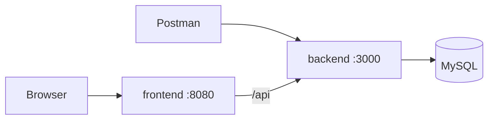

# Streakline

A habit tracker. You create habits and log a check-in for each day you keep them. The API stores those days in MySQL and computes the current streak and the longest streak from the check-in history.

The stack is three containers on one Docker network:

- **frontend** — React page, served by nginx
- **backend** — FastAPI
- **db** — MySQL 8.4



The page and Postman talk to FastAPI. FastAPI reads and writes MySQL over the `habitnet` network. nginx on the frontend proxies `/api/` to the backend container.

## Run

Install [Docker](https://docs.docker.com/get-docker/) with Compose, then from this folder:

```bash
cp .env.example .env
```

Open `.env` and replace the two passwords. Do not commit `.env`.

Start everything:

```bash
docker compose up --build
```

When the containers are healthy:

- UI: http://localhost:8080
- API: http://localhost:3000
- Interactive API docs: http://localhost:3000/docs

The first start creates the database and tables. Later starts reuse the saved data.

Stop the app with `Ctrl+C`, or from another terminal:

```bash
docker compose down
```

`docker compose down` keeps the database. To delete habits and check-ins as well:

```bash
docker compose down -v
```

## Try it

On the page, add a habit and log a few days. **Log the last 5 days** writes five check-ins so a streak shows up immediately. **Edit** changes a habit. **Remove** on a check-in deletes that day, and the streak totals update.

The same calls work against the API directly:

```bash
curl -s http://localhost:3000/health

curl -s -X POST http://localhost:3000/habits \
  -H 'Content-Type: application/json' \
  -d '{"name":"Read 20 pages","description":"A paper book before bed."}'

curl -s -X PATCH http://localhost:3000/habits/1 \
  -H 'Content-Type: application/json' \
  -d '{"name":"Read 30 pages","description":"A paper book before bed."}'

curl -s -X POST http://localhost:3000/habits/1/checkins \
  -H 'Content-Type: application/json' \
  -d '{"checked_on":"2026-10-17","note":"Finished the chapter."}'

curl -s 'http://localhost:3000/habits/1/stats?as_of=2026-10-17'

curl -s -X DELETE http://localhost:3000/habits/1/checkins/1
curl -s -X DELETE http://localhost:3000/habits/1
```

Every endpoint, with example bodies and tests, is in [docs/API.md](docs/API.md) and in [postman/Streakline.postman_collection.json](postman/Streakline.postman_collection.json).

Import that collection into Postman and run it with the Collection Runner from top to bottom. `baseUrl` is `http://localhost:3000`. The requests save the new habit id and check-in id for the later calls.

## How streaks are counted

A streak is a run of consecutive dates. The current streak is the longest run that still reaches yesterday (or today) relative to `as_of`. Two missed days reset it to zero. The longest streak is the best run in the whole history.

MySQL groups the dates. The page sends your local date as `as_of`. If you omit it, the API uses the current UTC date. The full rule and a worked example are in [docs/API.md](docs/API.md).

## Where the data lives

MySQL has two tables, created from `backend/sql/init.sql` the first time the volume is empty:

| Table | What it stores |
| --- | --- |
| `habits` | Name, description, and timestamps |
| `checkins` | One row per logged day, with an optional note |

A unique key on `(habit_id, checked_on)` allows only one check-in per habit per day. Deleting a habit deletes its check-ins.

The data directory is the named volume `streakline_v2_habit_data`, so the rows survive `docker compose down` and a rebuild. Compose calls this project `streakline-v2`.

## Configuration

Values come from `.env` and from the service environment in `compose.yaml`. Nothing secret is stored in the source.

| Variable | Used for |
| --- | --- |
| `MYSQL_ROOT_PASSWORD` | MySQL root password |
| `MYSQL_DATABASE` | Database name, default `habits` |
| `MYSQL_USER` | Application user, default `habits_app` |
| `MYSQL_PASSWORD` | Application password |
| `DB_HOST` | MySQL hostname inside the network. Compose sets `db` |
| `DB_PORT` | MySQL port inside the network, `3306` |
| `DB_USER` | Same as `MYSQL_USER` |
| `DB_PASSWORD` | Same as `MYSQL_PASSWORD` |
| `DB_NAME` | Same as `MYSQL_DATABASE` |
| `PORT` | Port uvicorn binds inside the backend container, `3000` |
| `BACKEND_PORT` | Host port for the API, default `3000` |
| `FRONTEND_PORT` | Host port for the page, default `8080` |
| `TZ` | `UTC` in the containers |

## Layout

```
backend/Dockerfile          image for the API
backend/app/main.py         routes, status codes, and request checks
backend/app/habits.py       MySQL reads, writes, and streak queries
backend/app/db.py           connection pool
backend/app/validate.py     dates and text limits
backend/sql/init.sql        habits and checkins tables
frontend/                   React page; nginx proxies /api to FastAPI
docs/API.md                 endpoint reference
postman/                    Postman collection
compose.yaml                database, backend, and frontend
```
